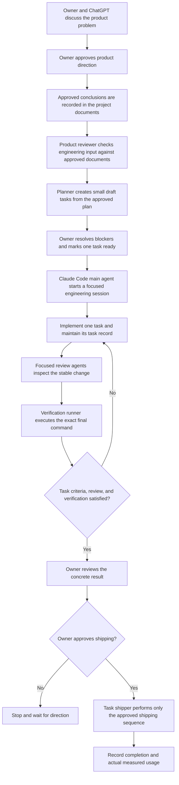
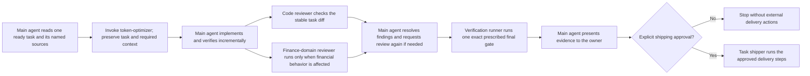

# Example Product and Agent Flows

This document maps a few operating practices from the Personal Finance source project to the portable workflow. It is a process example only: it does not copy product requirements, financial logic, architecture, application data, or private examples. A project adopting the starter must choose its own privacy rules, roles, tools, and approval gates.

## Does the template contain a personal-data rule?

The starter has privacy safeguards, but it does not impose the source project's full data policy on every adopter. `project.config.yml` requires each project to describe its data classes, prohibited data, access boundaries, and regulatory obligations in `required_project_facts.privacy_and_security_constraints`. The shared Git skill also checks that secrets and private data are not staged, and the handoff template excludes secrets and private data.

In the Personal Finance source project, a stricter domain-specific rule applies: real financial data stays private, and committed fixtures, tests, and demonstrations use synthetic data. New projects must define their own equivalent policy; they should not inherit that financial rule unless it fits their data and obligations.

## Is a product-reviewer rule included?

The starter preserves the responsibilities, not the source project's named agent. The product owner approves product direction and scope; an implementation reviewer checks a stable task diff against its criteria. The starter does not require a separate `product-reviewer` agent.

In the source project, product discovery and decisions happen between the owner and ChatGPT. The read-only `product-reviewer` agent does not conduct discovery or approve product scope; it checks a task, requirement detail, or implementation choice against the already-approved product documents and flags unsupported assumptions. A new project can configure a similar reviewer in `workflow.reviewers` when it has a concrete need, but should keep product approval with its named owner.

## Personal Finance product-to-delivery example

The owner remains the product and shipping authority. Product discovery does not assume that a complete specification already exists: if direction is unknown, bootstrap starts discovery and records unresolved questions before planning implementation.

## Main-agent and subagent example

In the source project, each subagent has a narrow input, tool boundary, and stopping condition: the planner breaks down an approved plan but does not approve tasks; the product reviewer reads approved product sources but does not decide product scope; the code reviewer reports task-scoped findings but does not fix them; the domain reviewer is conditionally invoked for affected financial behavior; the verification runner executes exactly one supplied command and does not debug failures; and the task shipper acts only after the owner explicitly approves shipping. The subagents do not invoke other agents.

These names and boundaries are examples, not requirements. The starter's reusable rule is to configure only reviewers or helpers that solve a real risk, give each a bounded task and explicit authority, preserve owner-controlled decisions, and never delegate an approval the owner retains.

## Mapping the example to a new project

| Personal Finance source practice | Portable starter behavior | New-project choice |
|---|---|---|
| Product conversations and scope approval are owner-controlled. | Product owner role and approval gates. | Identify the owner and decide where discovery and approvals are recorded. |
| A product reviewer checks consistency with approved product documents. | Separate product approval from task-diff review; reviewer roles are configurable. | Add a narrow product-consistency reviewer only if useful. |
| Real financial data is excluded from committed artifacts. | Required project privacy/security constraints plus private-data checks in Git guidance. | State what data is sensitive, prohibited, or safe for tests and examples. |
| Main Claude agent uses bounded helper agents for review, verification, and approved delivery. | Configurable reviewer/runner/operator roles; no required agent vendor or count. | Select agent tools, exact responsibilities, and whether delegation is appropriate. |
| Usage reports contain measured values only, otherwise unavailable. | Token report and handoff templates prohibit estimates. | Configure the available measurement source and authoritative report location. |

See [`workflow/OPERATING-MODEL.md`](../workflow/OPERATING-MODEL.md) for the portable process and [`project.config.template.yml`](../project.config.template.yml) for required privacy and optional reviewer configuration.
