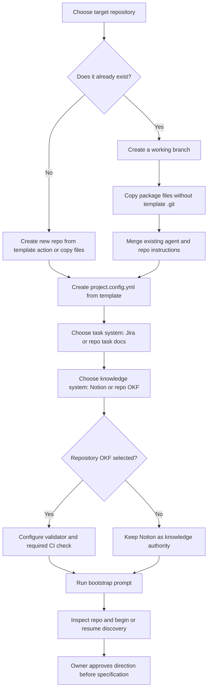

# Install the workflow in a repository

## Choose the installation path

- **New repository:** if [agent-workflow-starter](https://github.com/igavriel/agent-workflow-starter) is enabled as a GitHub template, use GitHub's **Use this template** action. Otherwise create an empty repository and copy the package files without its `.git` directory. Then run the bootstrap prompt.
- **Existing repository:** create a working branch in that repository, copy the template files into it without the template's `.git` directory, merge existing root instructions instead of overwriting them, and run the adoption prompt below. Do not merge the template repository's Git history into the application repository.

For an existing repository, copy the package at a reviewed version or commit. Preserve application files and local changes. Merge `AGENTS.md`, `CLAUDE.md`, `README.md`, `.gitignore`, `.gitattributes`, `.editorconfig`, and editor settings with existing files. Keep the target repository's own project instructions and customizations. Do not copy the template's `project.config.yml` because adopters create their own from `project.config.template.yml`.

## Ready-to-paste prompt for an existing repository

Run this in Claude Code or Codex with the existing repository as the working directory:

```text
Add the portable workflow from https://github.com/igavriel/agent-workflow-starter to this existing repository. Use the currently reviewed template version or commit and report which one you used.

First inspect this repository's agent instructions, README, relevant documentation, current Git state, and directory layout selectively. Follow the repository's existing task and branch guidance. Preserve application code, user changes, and project-specific instructions. Do not merge the template repository's Git history into this repository.

Copy the reusable template files, excluding the template's .git directory and any template project configuration. Merge colliding files such as AGENTS.md, CLAUDE.md, README.md, .gitignore, .gitattributes, .editorconfig, and editor settings instead of overwriting target content. Create project.config.yml from project.config.template.yml and adapt the agent entry files used in this repository to point to the shared workflow instructions; do not add entry files for unused agents unless the owner wants them. Record project-specific changes in workflow/LOCAL-CUSTOMIZATIONS.md.

Ask the owner to choose task management independently: Jira or repository task documents. Ask separately whether product knowledge belongs in Notion or an in-repository OKF bundle. Configure one authority and exact location for each. If repository knowledge is chosen, all durable knowledge concepts in that bundle must use OKF; configure and run scripts/validate-okf.py and add it as a required CI check. Session handoffs and token usage reports remain operational Markdown records. Do not duplicate editable records across authorities.

Inspect the selected agent's token-optimizer installation and instructions. Follow workflow/TOKEN-OPTIMIZER.md, but do not install it or configure hooks until the owner has reviewed the license/privacy handling and authorized installation. Record actual token measurements when available; otherwise use unavailable, never estimates.

Adapt the configuration to facts discovered in this repository. Do not assume the product is specified because code or a README exists. If approved product direction is missing, use prompts/bootstrap.md to begin product discovery, ask only essential unanswered questions, and do not build application code. If product decisions are already authoritative, preserve them and continue from their actual state. Do not invent the stack, commands, constraints, or approval.

Review the final diff for overwritten local content, broken references, and configuration assumptions. Report the selected task and knowledge authorities, files added or merged, validator/CI status, unresolved questions, and the next action. Do not commit, push, publish, or create external records unless this repository's instructions and the owner authorize it.
```

After installation, continue with [`../prompts/bootstrap.md`](../prompts/bootstrap.md) to configure the project and begin or resume product discovery. Set up OKF validation as a required CI check when the repository knowledge option is selected; configure branch protection in the hosting settings.

## Installation overview


