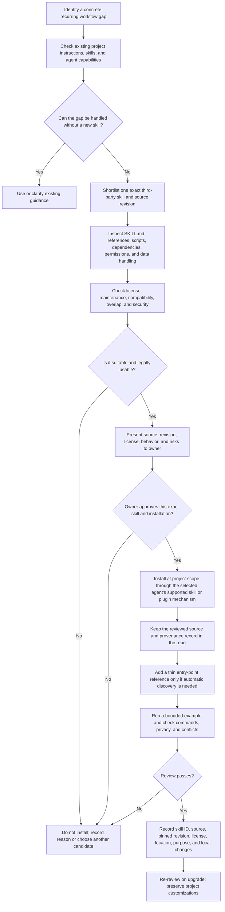

# Evaluating and adding third-party skills

Use this flow for optional third-party skills suggested for a project. It does not replace the separate required `token-optimizer` review and installation procedure in [`../workflow/TOKEN-OPTIMIZER.md`](../workflow/TOKEN-OPTIMIZER.md).

Only add a skill to solve a concrete workflow gap. Skills contain instructions and may include scripts or dependencies; treat upstream content as untrusted until reviewed. Do not copy whole skill collections or run upstream install scripts as a shortcut.

## Review checklist

- **Need and overlap:** State the concrete recurring task this skill improves. Compare it with `AGENTS.md`, `CLAUDE.md`, the shared operating model, installed skills, and available tools. Avoid a skill that repeats current guidance or adds process without a demonstrated need.
- **Provenance and license:** Identify the canonical repository, exact revision, license file, copyright notices, and any conditions for copying or adapting the content. If the license is absent, unclear, incompatible, or not approved, do not copy or install it.
- **Behavior and security:** Read the complete `SKILL.md` and every referenced file. Inspect scripts and commands for shell execution, network access, filesystem scope, credential access, telemetry, downloads, destructive actions, and prompt-injection instructions. Record data accessed, transmitted, and retained.
- **Compatibility and dependencies:** Check the selected agent's skill format and native discovery path, required executables/packages, project stack assumptions, and supported operating systems. Do not add a package, hook, integration, or account without the project's normal approval.
- **Owner approval:** Present the specific skill, pinned revision, license, behavior, required dependencies, destination, and proposed adaptations. `skills.third_party_installation_approved` defaults to `false`; a general preference for skills is not approval to install an exact third-party skill.
- **Installation and activation:** If the project chooses to vendor a reviewed/adapted skill, keep one canonical copy in `skills/<skill-name>/`. If the project instead uses an approved plugin manager, record the exact package and pinned revision rather than copying upstream files. If automatic discovery is wanted for a vendored skill, create a thin entry under the selected agent's native project skill directory that points to the canonical source; do not maintain two drifting copies of the full skill. Claude Code documents project skills under `.claude/skills/`; Codex repository guidance uses `.agents/skills/`. Confirm current tool documentation if paths or formats change.
- **Validation:** Test one representative, low-risk scenario. Confirm that the skill activates or can be invoked, references resolve, scripts behave as described, and no instruction conflicts with project approvals or privacy rules. Remove the native entry and references if validation fails.
- **Record and maintain:** Add the skill ID, repository URL, pinned commit/version, license, agent-specific installation path, purpose, approval, and local changes to `project.config.yml` and `skills/README.md`. Re-review the source and diff before upgrades; keep local customizations separate and remove stale references when a skill is dropped.

## Native project skill locations

- Claude Code project skills: [`.claude/skills/<skill-name>/SKILL.md`](https://platform.claude.com/docs/en/agents-and-tools/agent-skills/overview).
- Codex repository skills: [`.agents/skills/<skill-name>/SKILL.md`](https://developers.openai.com/blog/skills-agents-sdk).

A skill kept only under this template's `skills/` folder is portable source material and can be read by an explicit repository instruction, but that location alone does not register it for native skill discovery. Use an agent-specific thin entry if the project wants the agent to discover it automatically. For a skill used by both agents, keep one canonical body and make the two entries point to it.

## Keep separate from token-optimizer

`token-optimizer` is a required external workflow plugin, with its own license/privacy review and setup sequence. Follow [`../workflow/TOKEN-OPTIMIZER.md`](../workflow/TOKEN-OPTIMIZER.md); this optional-skill evaluation flow does not authorize installation or replace the plugin-specific steps.
