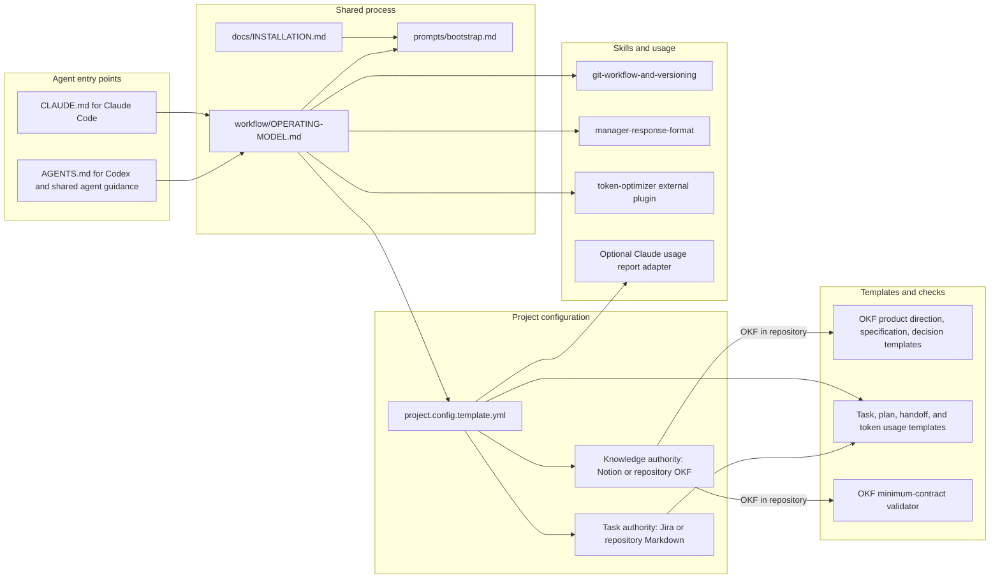
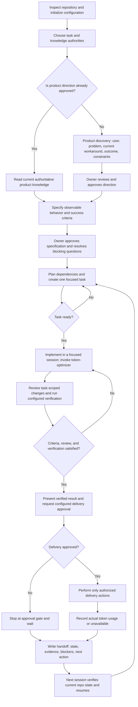

# What the template provides and how work flows

## Template contents

The package supplies portable process guidance and starter artifacts. It does not supply application code or Jira/Notion connections. Configure the two system choices independently: Jira or repository task records; Notion or repository OKF knowledge. Repository knowledge must pass the OKF validator. The external `token-optimizer` skill must be installed for the chosen agent only after its license and privacy behavior have been reviewed.

## Product-to-delivery process

Stages may collapse for small changes, but the relevant approval and verification gates remain. Discovery starts from the repository's actual state: if product direction is not approved, the agent asks essential questions and explores the problem instead of assuming a finished specification.

The token optimizer supports context reduction at task start and before handoff or compaction. It must preserve the active task, authoritative sources, unresolved blockers, privacy rules, and verification evidence. Token and cost figures in handoffs are actual measurements only; record `unavailable` when the platform does not expose them. See [`workflow/TOKEN-OPTIMIZER.md`](../workflow/TOKEN-OPTIMIZER.md) and [`workflow/OPERATING-MODEL.md`](../workflow/OPERATING-MODEL.md).
